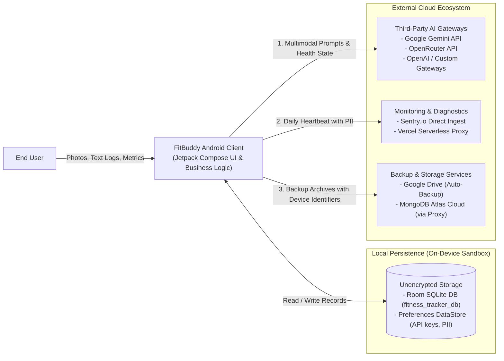
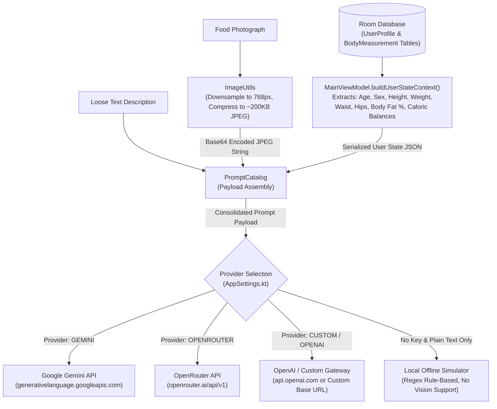
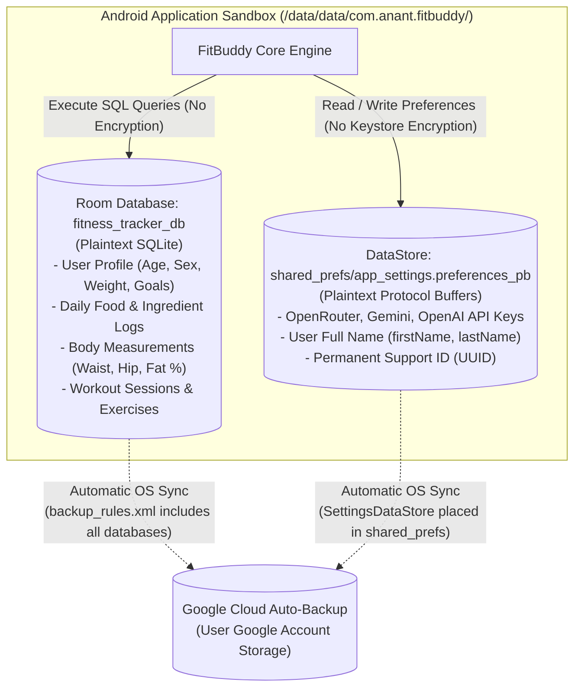
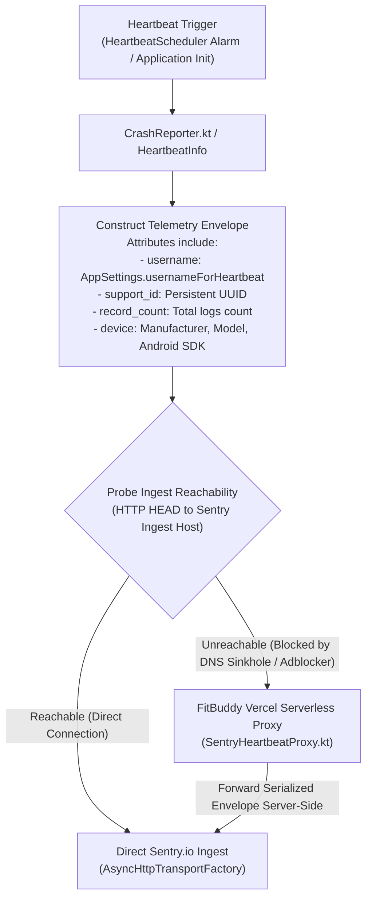
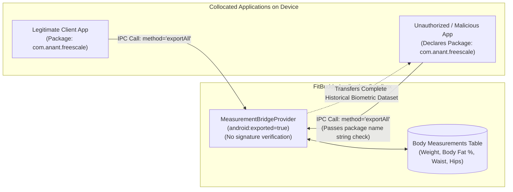
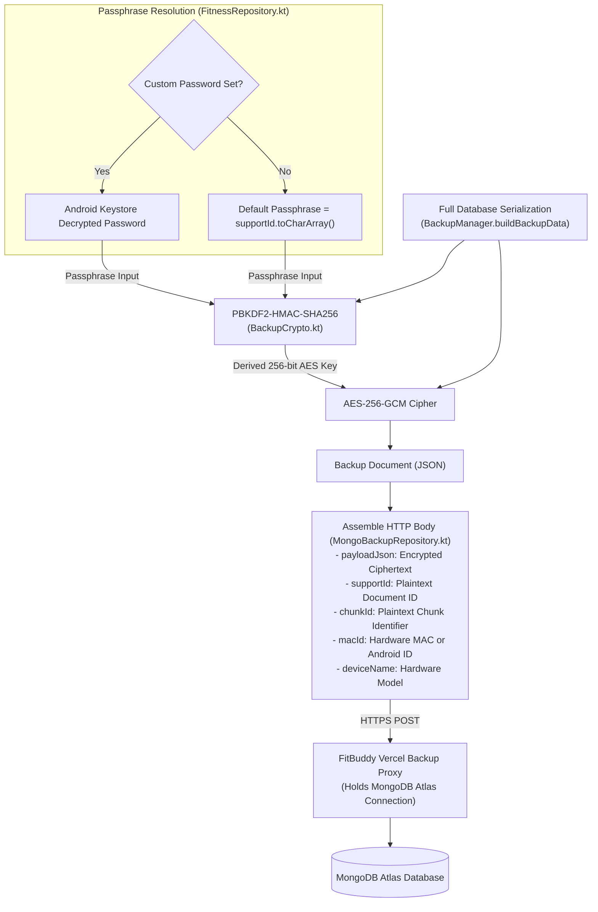

# FitBuddy Architecture & Data Flow Diagrams
**Document Type:** Technical Architecture Specification & Privacy Threat Modeling Artifact  
**Target Audience:** Security Architects, Data Protection Officers (DPO), and C-Level Executives  
**Scope:** FitBuddy Android Application (`com.anant.fitbuddy`)

---

## 1. High-Level System Architecture (Abstract Overview)

This high-level diagram illustrates the primary components of the FitBuddy ecosystem, distinguishing between on-device operations, unencrypted local persistence, and external cloud services.

---

## 2. Multimodal AI Processing & Data Minimization Flow

This diagram illustrates the processing pipeline for food and workout logging, demonstrating that multimodal processing is delegated entirely to cloud-hosted Large Language Models (LLMs) rather than executed via Edge AI. Furthermore, it highlights the structural violation of the Data Minimization Principle (GDPR Art. 5(1)(c)), wherein extensive medical and biometric data are bundled into food analysis prompts.

---

## 3. Local Storage Persistence & Google Cloud Auto-Backup

This diagram models the data-at-rest layer, demonstrating the absence of application-level database encryption (SQLCipher) and highlighting the automatic exfiltration of health profiles and API credentials to Google Cloud via Android Auto Backup.

---

## 4. Telemetry, Hardware Identifiers & Sinkhole Evasion

This diagram details the telemetry pipeline implemented in `CrashReporter.kt` and `SentryHeartbeatProxy.kt`. It documents how identity attributes (full name) are dispatched despite in-app claims of anonymity, and illustrates the mechanism designed to bypass network-level privacy filters (e.g., Pi-hole, AdGuard, corporate DNS sinkholes).

---

## 5. Inter-Process Communication (IPC) Vulnerability

This diagram outlines the vulnerability present in `MeasurementBridgeProvider.kt`. Because the `ContentProvider` is declared with `android:exported="true"` without defining an `android:permission` or enforcing cryptographic signature checks, unauthorized applications can extract historical biometric readings.

---

## 6. Cloud Backup Cryptographic Key Separation Failure

This diagram documents the cryptographic key management flaw within the cloud backup subsystem (`FitnessRepository.kt` and `MongoBackupRepository.kt`). When a custom password is not supplied, the public `supportId` identifier is utilized as the key derivation passphrase, nullifying the confidentiality guarantees of AES-256-GCM.

